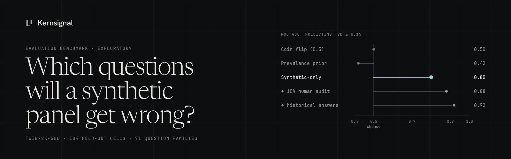

# Kernsignal evaluation benchmark

Synthetic survey respondents ("digital twins") are cheap, but they quietly
diverge from real people on some questions and not on others. This repository
measures where they diverge and tests whether a small, leakage-controlled
model can predict that from the synthetic answers alone, so human review can
be aimed at the questions that need it. It reproduces a human versus GPT-4.1-mini
comparison on the public Twin-2K-500 dataset and checks how far the result
transfers to an independent study (GSS). The results are exploratory and come
from published academic data, not from any commercial vendor panel. Full write-up:
[kernsignal.ai/benchmark](https://kernsignal.ai/benchmark/).

## Headline results

Twin-2K-500, GPT-4.1-mini versus human Wave 4 answers, with respondents and
question families held out: **104 withheld cells from 71 question families**,
mean total-variation distance (TVD) **0.267**, modal-answer disagreement
**26.9%**, historical human-versus-human TVD **0.032**.

| Risk-prioritization arm | Family-balanced Brier (lower is better) | ROC AUC | Lift at top 20% | Requires human answers? |
|---|---:|---:|---:|---|
| Prevalence-only | 0.2596 | 0.422 | 0.81x | During training only |
| Uninformative 0.5 forecast | 0.2500 | 0.500 | 1.00x | No |
| **Synthetic-only** | **0.1897** | **0.802** | **1.33x** | During training only |
| 10% contemporary human audit | 0.1655 | 0.883 | 1.55x | Yes |
| Historical human answers | 0.1409 | 0.922 | 1.55x | Yes |

Transfer to an independent study, with the Twin-2K model frozen (no refit) and
scored on 110 GSS cells from 10 question families:

| Metric | Value |
|---|---|
| ROC AUC | 0.75 [0.55, 0.89] |
| Top-20% review lift | 1.59x [1.22, 2.17] |
| Brier gain vs constant | +0.040 [-0.028, 0.106] (not distinguishable from zero) |
| Mean predicted vs observed flag rate | 0.53 vs 0.63 |

The ranking transfers; the probabilities do not. Details and caveats:
[docs/RESULTS.md](docs/RESULTS.md), [docs/TRANSFER_GSS.md](docs/TRANSFER_GSS.md),
[docs/limitations.md](docs/limitations.md), [docs/architecture.md](docs/architecture.md).

## Quickstart

Python 3.11 or 3.12.

```bash
git clone https://github.com/essentialols/kernsignal-benchmark
cd kernsignal-benchmark
pip install -r requirements-dev.txt 'huggingface_hub[hf_xet]>=0.30,<2'
python -m scripts.twin2k_benchmark --revision f883165a3026fde855dfd448e0cd16443ab257b6
```

The last command downloads the pinned Twin-2K-500 files (about 12 MB) into
`data/twin2k`, runs the benchmark and writes `artifacts/twin2k/validation.json`.
Both directories are git-ignored. Use a virtual environment (`python -m venv .venv && source .venv/bin/activate`) first.

GSS transfer (optional): fetch the pinned third-party replication package as
described in [docs/TRANSFER_GSS.md](docs/TRANSFER_GSS.md), then run
`python -m scripts.cross_study_benchmark`.

### Offline tests and demo

No network or data is needed for the test suite or the demo scorecard:

```bash
pytest
python -m scripts.make_demo_panels --out data/demo_pair
python -m kernsignal.cli score-panels \
  --human data/demo_pair/human.csv \
  --synthetic data/demo_pair/synthetic.csv \
  --output-dir artifacts/scorecard
cat artifacts/scorecard/scorecard.md
```

Both demo panels are simulated, with deliberately injected distortions. The
demo shows the scorecard mechanics, not evidence about any real system.

## Data and licenses

This repository ships no data. Code is MIT-licensed ([LICENSE](LICENSE)).
Third-party data keeps its own license ([NOTICE](NOTICE)):

- Twin-2K-500, `LLM-Digital-Twin/Twin-2K-500` on Hugging Face, revision
  `f883165a3026fde855dfd448e0cd16443ab257b6`: CC BY 4.0.
- GSS replication package (MIT code, CC BY 4.0 data), pinned commit
  `76aa0376835b60c5dd54851a6fc4e77e32753465`. Its World Values Survey files are
  not used.

## Citation

```bibtex
@software{sturm2026kernsignal,
  author = {Sturm, Ingmar},
  title  = {Kernsignal evaluation benchmark},
  year   = {2026},
  url    = {https://github.com/essentialols/kernsignal-benchmark}
}
```

If you use the Twin-2K-500 data, please also cite its authors (see the dataset
card on Hugging Face).
